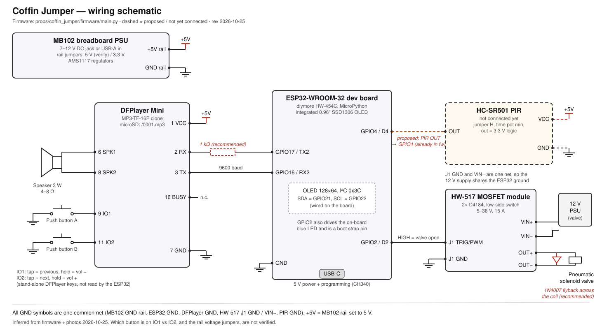

# Coffin Jumper wiring

Hardware documentation for the coffin jumper prop. The pin assignments come
from [`../firmware/main.py`](../firmware/main.py), which is the source of
truth. The parts and connections were identified from photos of the
breadboard build (2026-10-25) and the product images in
[`docs/`](../../../docs/).

## Parts

| Ref | Part | Identified as | Notes |
|---|---|---|---|
| U1 | ESP32 dev board with OLED | diymore **HW-454C**, ESP32-WROOM-32, CH340, USB-C | 0.96" SSD1306 OLED (128x64, I²C 0x3C) wired on the board to GPIO21/22. Product photos: `docs/diymore ESP32 development board with OLED/` |
| U2 | MP3 player | **DFPlayer Mini** clone, silkscreen `MP3-TF-16P` | microSD, 3 W mono amplifier on SPK1/SPK2, UART 9600 baud. Datasheet: `docs/pdfs/dfplayer-mini.pdf` |
| U3 | "Relay" board | **HW-517** dual-MOSFET trigger switch (2x D4184, 5-36 V, 15 A) | Not a relay: a low-side MOSFET switch with no isolation. Product photos: `docs/400W FET Trigger Switch Drive Module Board 5V-36V/` |
| U4 | Breadboard power supply | **MB102** (7-12 V DC jack or USB-A in) | Two AMS1117 regulators; each rail pair is jumpered to 3.3 V or 5 V |
| U5 | PIR sensor | **HC-SR501** | Not connected yet. Datasheet: `docs/pdfs/HC-SR501 PIR module.pdf` |
| SW1, SW2 | Push buttons (red, yellow) | 12 mm tactile | Wired to the DFPlayer, not to the ESP32 |
| LS1 | Speaker | ~3 W, 4-8 Ω enclosure speaker | |
| Y1 | Pneumatic solenoid valve | | Supplied by its own 12 V PSU through U3 |

## Connections

### ESP32 (U1)

| ESP32 pin | Board label | Connects to | Firmware constant |
|---|---|---|---|
| GPIO17 | TX2 | DFPlayer pin 2 RX (1 kΩ series resistor recommended) | `UART_TX` |
| GPIO16 | RX2 | DFPlayer pin 3 TX | `UART_RX` |
| GPIO2 | D2 | HW-517 J1 TRIG/PWM (HIGH = valve open) | `PIN_SOLENOID` |
| GPIO4 | D4 | HC-SR501 OUT (proposed, see below) | `PIN_PIR` |
| GPIO21 | D21 | OLED SDA (on the board) | `I2C_SDA` |
| GPIO22 | D22 | OLED SCL (on the board) | `I2C_SCL` |
| GND | GND | Common ground | |
| USB-C | | 5 V power and programming | |

### DFPlayer Mini (U2)

| Pin | Name | Connects to |
|---|---|---|
| 1 | VCC | +5 V breadboard rail |
| 2 | RX | ESP32 GPIO17 (TX2) |
| 3 | TX | ESP32 GPIO16 (RX2) |
| 6 | SPK1 | Speaker |
| 7 | GND | GND rail |
| 8 | SPK2 | Speaker |
| 9 | IO1 | Push button to GND (tap = previous track, hold = volume down) |
| 11 | IO2 | Push button to GND (tap = next track, hold = volume up) |
| 16 | BUSY | Not connected (the firmware polls status over UART instead) |
| 4, 5, 10, 12-15 | DAC_R, DAC_L, ADKEY, USB | Not connected |

Pin numbers count down the left side (1-8, VCC at the top) and up the right
side (9-16, IO1 at the bottom), with the SD slot at the bottom.

The SD card plays `/0001.mp3` as the action sound (`ACTION_FOLDER = 0`,
`ACTION_TRACK = 1`).

### HW-517 MOSFET module (U3)

| Terminal | Connects to |
|---|---|
| J1 TRIG/PWM | ESP32 GPIO2 |
| J1 GND | ESP32 GND |
| VIN+ / VIN- | 12 V valve power supply |
| OUT+ / OUT- | Solenoid valve coil |

The board switches OUT- to VIN- (low side), and J1 GND, VIN- and OUT-
(when on) share one net. So the 12 V supply's negative becomes common with the
ESP32 ground. That is expected and required for the switch to work.

### Power

- MB102 rails: +5 V for the DFPlayer (and the PIR once connected).
- ESP32: powered over its own USB-C cable.
- All grounds are tied together: MB102 GND rail, ESP32 GND, DFPlayer GND,
  HW-517 J1 GND (= VIN-), PIR GND.

## Connecting the PIR sensor

The firmware already supports the PIR on **GPIO4 (D4)**, with an internal
pull-down, a rising-edge interrupt, a 5 s warm-up, debounce and a 7 s
lockout. No firmware change is needed to wire it up.

| HC-SR501 pin | Connect to |
|---|---|
| VCC | +5 V rail (the module's regulator needs 4.5-20 V; 3.3 V is not enough) |
| OUT | ESP32 GPIO4 / D4 (the output is already 3.3 V logic, so no level shifter) |
| GND | GND rail |

The pin order is printed on the PCB under the white Fresnel lens; check it
before plugging in, since clones differ.

Recommended HC-SR501 settings:

- **Trigger jumper on H** (repeat trigger). The output stays high while motion
  continues, so one visitor gives one rising edge.
- **Time-delay pot fully counter-clockwise** (about 3 s). The firmware latches
  the edge itself, so a long hold time only delays re-arming.
- **Sensitivity pot** to taste. Mid-range reaches about 3-4 m.

Once connected, the prop fires the valve on motion as soon as it is `armed`.
Use `block` from the dashboard while testing.

## Wiring notes and recommendations

- **Flyback diode.** The HW-517 has no freewheeling diode. Put a 1N4007 (or
  faster, such as an SS34 or 1N5819) across the valve coil, cathode to OUT+.
- **1 kΩ in the DFPlayer RX line.** The DFPlayer datasheet recommends it, and
  it reduces hum from the speaker when running from 5 V.
- **GPIO2 is a boot strapping pin** and also drives the board's blue LED.
  It works because the pin is low at boot and the firmware drives it LOW
  first thing. Don't add a pull-up to it, or flashing can fail.
- **Gate drive at 3.3 V.** The D4184 MOSFETs turn on at 3.3 V, but not
  fully. That's fine for a valve coil drawing under about 2 A. For a heavier
  load, use a logic-level gate driver.
- **Common ground** between the ESP32 and the breadboard rail is needed for
  the UART link. If the ESP32 GND pin is not tied to the rail, add a jumper.

## Not verified from the photos

- Which button (red or yellow) is on IO1 and which on IO2.
- Whether the MB102 rail jumpers are set to 5 V or 3.3 V. 5 V is recommended
  for the DFPlayer amplifier.
- The exact header pins of the stacked jumper housings on the ESP32. The
  table above follows the firmware, so if the board does not behave as
  described, check the wiring against it.

## Proposed firmware changes (awaiting approval)

These are suggestions only and have not been made:

1. Raise `PIR_WARMUP_MS` from 5 s to about 60 s. The HC-SR501 needs 30-60 s
   after power-on to settle and can pulse its output during that time, which
   would fire the coffin right after a reboot.
